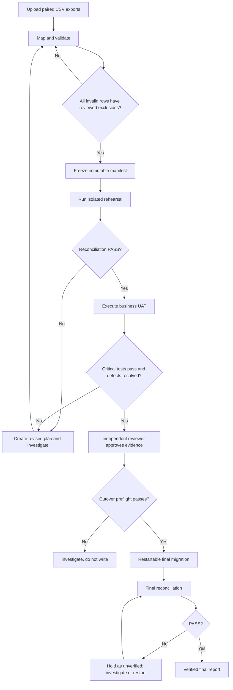
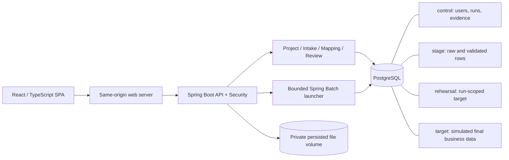

# MigrateFlow
## Legacy Data Migration, Reconciliation & Cutover Workbench

**Document:** Build-ready product and engineering specification  
**Status:** Reviewed design; implementation not yet started  
**Purpose:** A credible, demonstrable solo-developer backend engineering project  
**Scenario:** One-time offline CSV migration from a fictional legacy sales system to a simulated order-management database  
**Primary stack:** Java 21, Spring Boot, Spring Batch, PostgreSQL, React, TypeScript, Docker Compose  
**Last design review:** 14 November 2026

> **Scope statement:** “Build-ready” means the domain model, contracts, states, invariants, implementation order, and acceptance criteria are specified well enough to begin coding. This document is not an assertion that the application, benchmarks, or tests already exist. Any implementation changes must be reflected here and in architecture decision records.

---

## 1. Product decision

MigrateFlow is an **internal migration operations application**, not a universal ETL platform, a full test-management suite, or a commercial SaaS product. It coordinates the movement of two related business datasets—customers and orders—through a controlled sequence:

**intake → mapping → validation → exception decisions → frozen manifest → rehearsal → reconciliation → business UAT → approval → cutover → final reconciliation**.

The distinguishing engineering value is *proven, auditable data movement*: every accepted target record can be traced to one source row, every exclusion is explicit, every approval refers to exact inputs and test evidence, and failed batch execution can be restarted without duplicate inserts.

### Success definition

A reviewer can start MigrateFlow locally, import known-imperfect synthetic CSV files, inspect exactly which rows are invalid, approve their omission, rehearse the migration into isolated tables, prove reconciliation, execute business UAT, approve the frozen plan, migrate into an initially empty simulated final target, interrupt and safely restart a test run, and download complete evidence.

### Explicit non-claims

This is **not** a production migration service. It does not implement direct SAP/Oracle connectors, near-zero downtime, distributed transactions, reconciliation against an external live application, general rollback, or multi-tenant hosting. Architectural boundaries are deliberately chosen so the working project can demonstrate real engineering behavior without pretending to have solved unrelated enterprise challenges.

---

## 2. Business scenario and operating assumptions

**Company:** Hinata Trading Co. (fictional Japan-based distributor).  
**Legacy system:** An outdated sales application that produces point-in-time customer and historical-order CSV exports.  
**Target system:** An equally fictional replacement order-management application represented by a fixed PostgreSQL target schema.  
**Business objective:** Transfer the approved customer/order snapshot during a planned maintenance window, then verify that the target contains precisely the approved business data.

**Operating assumptions:**

1. The business supplies a consistent pair of offline exports from a single agreed export event. MigrateFlow records their stated export timestamp but cannot independently prove the external system stopped changing.
2. The first target is empty. There are no existing records to update, merge, or preserve.
3. Customers are loaded before orders. An accepted order must reference exactly one accepted customer.
4. The simulated final target is writable only through MigrateFlow in the demo; there are no concurrent external target writers.
5. Amounts are whole Japanese yen; use `BIGINT`/Java `long` with checked overflow. No floating point and no currency conversion.
6. Files and user accounts are synthetic. No real personal data is needed for development, screenshots, or public demonstrations.
7. The application has one backend instance and one bounded background worker pool. Multi-instance coordination is excluded.
8. A failure after committed chunks requires restart or operator investigation; the entire migration is **not** globally transactional.

### Typical users

| Role | Responsibilities | Not allowed |
|---|---|---|
| `ENGINEER` | Create project, upload files, configure mappings, validate, prepare exclusions, freeze plan, launch/restart runs | Approve their own manifest or cutover |
| `REVIEWER` | Decide exclusions, execute UAT, manage defects, approve/reject a cutover | Edit mappings or execute migration |
| `AUDITOR` | Inspect evidence, reports, manifests, and activity | Modify project or run state |
| `ADMIN` | Seed/manage demo users and project memberships, inspect operations | Bypass quality gates or approve work they prepared |

Authorization is the intersection of the user's global role and active project membership, checked on every request and download.

---

## 3. Scope and requirements

### 3.1 Must ship

- Private CSV file uploads, checksums, data profiling, deterministic source row numbering, immutable source retention.
- Configurable mappings for two **known** target entity types, and immutable mapping revisions.
- Explicit rule-set revision, deterministic transformations, validation issues, duplicate handling, and dependent-order checks.
- Reviewed exclusion decisions with reasons, without permitting invalid rows to be written.
- Immutable manifest that binds source hashes, mapping revisions, validation snapshot, excluded rows, and target contract.
- Asynchronous Spring Batch rehearsal into run-isolated PostgreSQL tables.
- Full reconciliation: conservation, counts, business-key sets, relationships, monetary totals, normalized field equality, provenance.
- Small, scenario-specific UAT checklist, defect logging, retest, and reviewer approval.
- Controlled insert-only final cutover with database-enforced uniqueness, same-run restart, and post-cutover reconciliation.
- Login/session security, project RBAC, append-only audit, structured logs, pagination, CSV/JSON reporting, integration tests, Docker Compose, CI.

### 3.2 Must not ship initially

- Excel/XLSX, live database connections, CDC/sync, update/delete/upsert migrations, arbitrary SQL/transformation scripts, visual ETL builders, generic test-case-management platform, AI mapping, Kafka/Redis, microservices, cloud hosting, production rollback, enterprise SSO, multi-tenancy.

### 3.3 Operating limits for the demo

| Limit | Initial policy |
|---|---|
| File type | CSV only, UTF-8; optional UTF-8 BOM accepted |
| Maximum file size | 10 MiB per file, configurable |
| Maximum data rows | 10,000 per file, configurable |
| Column count | 50 per file |
| CSV fields | RFC 4180-style quoting; a malformed row fails the upload, not silently skipped |
| Import files per bundle | Exactly one customers file and one orders file |
| Rehearsal/cutover concurrency | One worker job per project at a time |
| Default batch chunk | 100 rows, measured rather than advertised as a throughput guarantee |
| Export formats | JSON evidence and escaped CSV reports |

Limits are development guards, not verified performance claims. Benchmark larger loads only after correctness tests pass.

---

## 4. Source and target data contracts

### 4.1 Input CSVs

**`customers.csv`**

```csv
Cust_No,Customer_Name,Email,Join_Date
C0001,Sakura Retail,SAKURA@EXAMPLE.COM,2025/01/12
C0002,Haruto Supplies,haruto@example.com,2025/01/13
```

**`orders.csv`**

```csv
Order_No,Cust_No,Order_Dt,Amount_JPY,State
O0001,C0001,2025/02/01,12000,N
O0002,C0002,2025/02/03,25000,P
```

- Header names must match the configured source columns, are case-sensitive after UTF-8 BOM removal, and must be unique and nonblank.
- Preserve the physical CSV record number **and** parsed data-row ordinal; report a human-facing line reference. Embedded newlines may mean physical line and record ordinal differ.
- An empty string or whitespace-only optional email becomes `NULL`. Required identifiers and names may not be blank after trim.
- No implicit encoding fallback, Excel formula evaluation, locale-dependent parsing, or silent numeric truncation.
- Store original bytes privately and record `sha256`, `size_bytes`, `uploaded_by`, `uploaded_at`, `exported_at` (declared), and `dataset_kind`.

### 4.2 Normalized target contracts

| Entity | Field | Type | Rule |
|---|---|---|---|
| Customer | `id` | UUID | Generated target surrogate key |
| Customer | `external_customer_id` | VARCHAR(32) | Required; trim + uppercase; unique |
| Customer | `full_name` | VARCHAR(200) | Required, trimmed |
| Customer | `email` | VARCHAR(254) nullable | Trim + lowercase; if present, valid format |
| Customer | `joined_on` | DATE nullable | Parse configured `yyyy/MM/dd` format |
| Order | `id` | UUID | Generated target surrogate key |
| Order | `external_order_id` | VARCHAR(32) | Required; trim + uppercase; unique |
| Order | `customer_id` | UUID | Required FK to migrated customer |
| Order | `order_date` | DATE | Required parsed date |
| Order | `amount_yen` | BIGINT | Required, integer, `>= 0` |
| Order | `status` | VARCHAR(16) | One of `NEW`, `PAID`, `SHIPPED`, `CANCELLED` |

Both entities additionally record `origin_run_id`, `origin_manifest_id`, `source_file_id`, `source_row_number`, and `created_at`. Source metadata is provenance only; never return private file storage paths in an API.

**Default status mapping:** `N → NEW`, `P → PAID`, `S → SHIPPED`, `C → CANCELLED`. No unknown status is guessed. `Join_Date` may be blank; `Order_Dt` may not. Email uniqueness is **not** required for this domain, although duplicate business IDs are prohibited.

### 4.3 Transformation engine

Allow-list only: `TRIM`, `UPPERCASE`, `LOWERCASE`, `NULL_IF_BLANK`, `PARSE_DATE(pattern)`, `PARSE_LONG`, `ENUM_MAP(values)`, `DEFAULT_VALUE(value)`.

Specify ordering per mapping (for example, `TRIM → UPPERCASE`). Validate rule arguments when saving; save canonical JSON. The target field type, allowed transformations, null behavior, and error code must be deterministic. No custom expressions, reflection-based script execution, arbitrary JavaScript, or SQL snippets.

Example mapping rule:

```json
{
  "dataset": "CUSTOMERS",
  "sourceColumn": "Cust_No",
  "targetField": "external_customer_id",
  "steps": [{"operation": "TRIM"}, {"operation": "UPPERCASE"}],
  "required": true
}
```

### 4.4 Validation and exclusion policy

| Code | Trigger | Treatment |
|---|---|---|
| `REQUIRED_VALUE` | Required normalized field missing | Invalid; exclusion or correction |
| `DATE_FORMAT` | Date cannot parse exactly | Invalid; exclusion or correction |
| `EMAIL_FORMAT` | Nonblank malformed email | Invalid; exclusion or correction |
| `NEGATIVE_AMOUNT` | Amount is negative | Invalid; exclusion or correction |
| `INTEGER_FORMAT` | Amount is noninteger/overflow | Invalid; exclusion or correction |
| `INVALID_STATUS` | Order status unmapped | Invalid; exclusion or correction |
| `DUPLICATE_BUSINESS_KEY` | Same normalized ID appears in >=2 source rows | **All** occurrences invalid |
| `UNKNOWN_CUSTOMER` | Order does not resolve to exactly one valid accepted customer | Invalid, nonwaivable |
| `FIELD_TOO_LONG` | Value exceeds target type | Invalid; exclusion or correction |

Rows with any `ERROR` issue are never inserted. A reviewer may **approve their exclusion**, not waive their invalidity. Orders referencing any rejected or excluded customer are invalid and must themselves be excluded. Run dependency validation after the customer validity set is computed. Reviewer exclusion decisions do not change eligibility: a row failing validation is already ineligible, and approval merely authorizes its omission. If source files or mappings change, create an entirely new validation snapshot and collect fresh exclusion decisions. For the initial implementation, no manual in-place source-row editing: correct a file and upload a new immutable bundle, or revise the mapping, then revalidate.

**Conservation invariant (per dataset):** `raw_data_rows = accepted_rows + excluded_rows`. A rejected row without a reviewer-approved exclusion blocks manifest freeze. Warnings do not change acceptance counts. Classification is mutually exclusive. Per-issue counts may overlap and must never be summed as row counts.

**Exclusion eligibility (pinned):** Exclusion decisions apply **only** to rows carrying at least one `ERROR` issue. A row that passes validation can never be excluded — there is no business-initiated exclusion of valid rows (for example decommissioned or test accounts) in this design; such rows must be removed from the source export and a new bundle uploaded instead. The API enforces this: an `EXCLUDE` decision on a valid row is rejected (`422 ROW_NOT_INVALID`). A `KEEP` decision may be recorded against an invalid row to document that it was reviewed, but only `EXCLUDE` decisions resolve freeze eligibility.

---

## 5. End-to-end business workflow

1. Engineer creates a project, defines the maintenance window description, and registers the pair's declared export timestamp.
2. Engineer uploads the paired files. Each upload is private and immutable, with file hash and row metadata.
3. Engineer opens profiles and maps source fields to the two target contracts.
4. System executes validation into a new immutable **validation snapshot**, with typed normalized rows, issue codes, and business-key conflicts.
5. Engineer investigates all invalid rows. Reviewer approves specific exclusions with written reasons. Dependent orders are revalidated against accepted customers.
6. Engineer freezes a **manifest** referencing source files, mappings, rule set, validation snapshot, approved exclusions, and target contract.
7. Engineer launches a rehearsal identified by its own `run_id`. Its writer inserts into run-scoped rehearsal tables only.
8. System automatically reconciles the successful batch; a reconciliation failure leaves the rehearsal unverified.
9. Reviewer executes the required UAT checklist against that rehearsal's visible customer/order rows; defects are resolved and failed cases explicitly retested.
10. Reviewer signs an **approval record** that references the manifest, the verified rehearsal, the reconciliation report, and the UAT evidence revision.
11. Engineer launches final cutover. Server checks approval, actor separation, current manifest eligibility, database target emptiness, target contract version, and exclusive project cutover slot.
12. Batch writes customers and then orders to final target. Successful chunks commit independently. An interrupted run can resume with its exact identity.
13. A distinct post-cutover reconciliation compares accepted source against the actual final target. Only then is the cutover `VERIFIED`.
14. Auditor can inspect the append-only timeline and download evidence. No automatic mass-delete rollback is offered.

### Sequence of gates



---

## 6. Immutable identities, approvals, and revisions

The following distinctions remove the configuration/evidence circularity from the earlier draft.

| Object | Created when | Immutable content | Meaning |
|---|---|---|---|
| `dataset_bundle` | Paired upload | Two file IDs/hashes, declared export timestamp | Original source files |
| `mapping_revision` | Engineer publishes mappings | Canonical mapping JSON/hash | Transformation rules |
| `rule_set_revision` | Rule configuration published | Rule definitions/version/hash | Validation semantics |
| `validation_snapshot` | Validation completes | Exact normalized rows, issues, eligible rows | Reproducible assessed data |
| `exclusion_set` | Reviewer resolves exclusions | Row IDs, issue basis, approver/reason, hash | Explicit omissions |
| `manifest` | Engineer freezes plan | File hashes, revision IDs/hashes, snapshot, exclusion hash, target contract hash | **What to execute** |
| `rehearsal_run` | Rehearsal launched | Manifest ID, run identity, job params | What was executed in test |
| `reconciliation_report` | Rehearsal verifies | Counts, hashes, discrepancies, report digest | What was compared |
| `uat_evidence` | Reviewer completes tests | Rehearsal ID, test results, defect closure snapshot | Business acceptance evidence |
| `approval` | Reviewer signs off | Manifest hash + rehearsal ID + reconciliation digest + UAT evidence digest | **Permission to cut over** |
| `cutover_run` | Engineer executes | Manifest ID, approval ID, run identity | Final write attempt(s) |

**Rule:** A manifest is frozen *before* rehearsal. Rehearsal/UAT results are not retroactively inserted into a manifest. Approval binds those results to the manifest later.

**Canonical digests:** Build stable UTF-8 canonical serialization with explicitly ordered fields, sorted identifiers, normalized timestamps, and SHA-256; never hash raw application object `toString()` output. The display fingerprint is a shortened rendering of the stored full digest. A change creates a new revision/snapshot/manifest. Prior approvals remain immutable for audit but become **ineligible for new cutover** if their manifest is superseded or evidence is no longer valid. After approval, further UAT executions or defect changes require a new signed evidence digest and fresh approval. Creating an unrelated draft mapping does not mutate an approved manifest; selecting a newly frozen manifest for the project supersedes the prior one.

**No self-approval:** `approver_user_id != manifest.created_by` and `approver_user_id != cutover_run.requested_by`; the second check happens at cutover launch, before writing. ADMIN does not override it. UAT is bound to the same successful rehearsal used for approval. A new rehearsal requires fresh reconciliation, UAT, and approval if selected for cutover.

### Canonical digest contracts (pinned)

Every digest below is the lowercase hex SHA-256 of a UTF-8 string. These
contracts are exact: an independent implementation following them must
reproduce the stored digests byte for byte.

**Field-map digests** (manifest hash, mapping hash, rule hash) use the
canonical field serialization: fields sorted by name; each field rendered
as `name=` followed by its value and a newline (`\n`). A `null` value
renders as the literal `null`; a string renders as `<length>:<value>`
(length in characters); a list renders as `[v1,v2,...]` with each element
rendered by the same rules. The manifest hash field set is exactly:
`bundleId`, `customersSha256`, `ordersSha256`, `mappingRevisionId`,
`mappingHash`, `ruleSetRevisionId`, `ruleHash`, `snapshotId`,
`exclusionHash`, `targetContractHash`.

**Exclusion-set hash:** one line per excluded row,
`<DATASET>:<sourceRowId>|<reason>|<reviewerUserId>` (dataset is
`CUSTOMERS` or `ORDERS`), lines sorted lexicographically, joined with
`\n` (no trailing newline).

**Target contract hash:** SHA-256 of the versioned target-contract
descriptor string. The v1 descriptor is
`customers(external_customer_id:VARCHAR32:unique,full_name:VARCHAR200,email:VARCHAR254:nullable,joined_on:DATE:nullable);orders(external_order_id:VARCHAR32:unique,external_customer_id:FK,order_date:DATE,amount_yen:BIGINT>=0,status:NEW|PAID|SHIPPED|CANCELLED);v1`.
Any change to the target contract must change the descriptor and bump its
trailing version; manifests bind the descriptor hash, so a contract change
can never silently ride on an old manifest.

**UAT evidence hash:** one line per UAT case of the rehearsal, ordered by
`case_key`: `<caseKey>=<latestResult>|<executedByUserId>|<executedAtUtc>`,
where `executedAtUtc` is the latest execution's timestamp formatted in UTC
as `YYYY-MM-DD"T"HH24:MI:SS.US"Z"` (microsecond precision). A case with no
execution renders as `<caseKey>=null`. Then one line per defect of the
rehearsal, ordered by defect ID: `defect:<defectId>=<severity>:<status>`.
Lines joined with `\n` (no trailing newline). Because the timestamp is
normalized to UTC before serialization, the digest is independent of the
database session timezone.

---

## 7. Architecture and execution design

### 7.1 Deployment



- One backend deployable, one frontend, one PostgreSQL service, one persisted private upload volume, all via Docker Compose.
- Serve React and `/api` from the same origin (e.g., local reverse proxy); in Vite development, proxy API requests so sessions/CSRF behavior is consistent.
- Feature-oriented modular monolith. Controllers never contain migration business logic. Modules use explicit application interfaces instead of reaching into each other's JPA repositories.
- Spring Batch jobs run asynchronously through a **bounded** executor; never hold the HTTP request open for processing. All start commands return `202 Accepted` and a run reference.
- Use a single PostgreSQL `DataSource` for application records, batch metadata, and target writes. The target is a schema **within the same DB**, not an external enterprise service.

### 7.2 Batch semantics

- `VALIDATE`: CPU/DB job that creates an immutable snapshot and issue report; no target writes.
- `REHEARSAL`: two sequential steps (`loadCustomers`, `loadOrders`) into rows scoped by `rehearsal_run_id`.
- `CUTOVER`: identical domain transformations, two sequential steps into `target` tables, and a post-job reconciliation step executed separately after batch completion.
- Use typed snapshot readers ordered by stable row IDs/ordinals and persisted step execution state. Do not read CSV again during cutover.
- For each job, the **identifying** Spring Batch job parameter is `runId` (plus a fixed job name that identifies rehearsal versus cutover). Restarts reuse the same identifying parameters and underlying `JobInstance`, creating a new `JobExecution` only when permitted. Do **not** pass a changing timestamp as an identifying restart parameter.
- Commit target rows **and their applied-row ledger entries in the same PostgreSQL transaction** for every chunk. Batch checkpoint state must also be persisted; replay is guarded by target constraints and the ledger if a checkpoint lags.
- A committed row is never silently overwritten. On replay, if the row and ledger both prove the exact same manifest/source/value, treat it as already applied. If they disagree, fail the run; do not silently `ON CONFLICT DO NOTHING` against unrelated data.
- Retry only classified transient failures with bounded retry/backoff; validation and DB-constraint violations fail closed. No skip-on-write-errors during approved cutover.
- A crash after at least one commit leaves a restartable run, not a fake fully rolled-back migration.

### 7.3 Single-writer and preflight

Create a **single shared** `control.target_cutover_slot` row for this deployment's one simulated final target. Final start uses a transaction that locks this singleton (`SELECT … FOR UPDATE`), verifies no competing active run or completed cutover, checks final target emptiness, validates current approval, then creates/reserves one cutover run. A per-project lock alone would be insufficient because every project writes to the same final target. An API retry with the same `Idempotency-Key` returns the existing run; a conflicting new request gets `409`.

A worker crash must not automatically release the reservation. A restart uses the **same** reserved run; a deliberately abandoned failed run requires explicit operator investigation before a controlled local demo reset. Ensure worker and control schemas use the same database so preflight and reservation are atomic. The one shared final target accepts only a single initial migration across all demo projects; additional projects may rehearse, but their final cutovers require a deliberate full demo reset.

### 7.4 Rehearsal isolation

Rehearsal tables are shared physical tables but **partitioned logically by `rehearsal_run_id`** in every query, unique key, and foreign-key relationship. Example uniqueness for customers: `(rehearsal_run_id, external_customer_id)`; for orders: `(rehearsal_run_id, external_order_id)`; order→customer FK must include `rehearsal_run_id`. Rehearsal data from prior runs therefore cannot collide with another run, and UAT cannot accidentally inspect records from a different rehearsal. Rehearsal and final schemas enforce the same *business validations*, but their indexing differs because rehearsal supports multiple runs.

### 7.5 Failure and recovery limits

- If parsing fails before a manifest exists, repair the file and re-upload.
- If validation fails, revise the plan and revalidate; no target rows exist yet.
- If rehearsal fails, restart that run if safe or start a new rehearsal with a new `run_id` after correcting the plan.
- If cutover fails, **do not run a new independent cutover** for the same manifest; inspect errors and restart the existing run if safe.
- If a constraint conflict indicates data not attributable to the run, stop and investigate. Do not delete it automatically.
- A verified final cutover cannot be launched again. No generic production rollback endpoint is provided.

---

## 8. Database model: authoritative minimum

All IDs are UUID unless stated otherwise. Use `TIMESTAMPTZ` for instants in UTC. Use PostgreSQL FK/check/unique constraints in addition to application validation. `JSONB` is for source variability, rule definitions, and evidence—not a replacement for core relational entities.

### 8.1 Schemas and control tables

| Table | Required columns beyond `id`, `created_at` | Essential constraints |
|---|---|---|
| `control.users` | `email`, `password_hash`, `display_name`, `role`, `enabled` | unique lowercased email; role allow-list |
| `control.projects` | `name`, `description`, `status`, `created_by` | creator FK; archive instead of deleting |
| `control.project_memberships` | `project_id`, `user_id`, `active` | unique `(project_id,user_id)` |
| `control.dataset_bundles` | `project_id`, `exported_at`, `status`, `uploaded_by` | project FK; exactly one active pair by selection |
| `control.source_files` | `bundle_id`, `kind`, `filename`, `storage_key`, `bytes`, `sha256`, `row_count`, `uploaded_by` | unique `(bundle_id,kind)`; private storage key |
| `control.mapping_revisions` | `project_id`, `revision_no`, `definition_json`, `definition_hash`, `published_by` | unique `(project_id,revision_no)`; immutable after publication |
| `control.rule_set_revisions` | `project_id`, `revision_no`, `rule_json`, `rule_hash` | unique revision per project |
| `control.validation_snapshots` | `project_id`, `bundle_id`, `mapping_revision_id`, `rule_set_revision_id`, `status`, `source_counts_json`, `validated_at` | immutable once completed |
| `control.validation_issues` | `snapshot_id`, `kind`, `source_row_id`, `code`, `severity`, `field`, `message` | indexes by snapshot/row/code |
| `control.exclusion_decisions` | `snapshot_id`, `kind`, `source_row_id`, `decision`, `reason`, `reviewer_id`, `decided_at` | one current decision per `(snapshot_id,kind,source_row_id)` before freeze; history preserved in audit |
| `control.manifests` | `project_id`, `bundle_id`, `mapping_revision_id`, `rule_set_revision_id`, `snapshot_id`, `exclusion_hash`, `target_contract_hash`, `manifest_hash`, `created_by`, `superseded_at` | unique manifest hash within project; immutable plan contents |
| `control.runs` | `project_id`, `manifest_id`, `kind`, `status`, `requested_by`, `request_key`, `batch_job_instance_id`, `processed_rows`, `started_at`, `finished_at` | unique `(project_id,request_key)` if key supplied; kind `REHEARSAL/CUTOVER` |
| `control.reconciliation_reports` | `run_id`, `status`, `summary_json`, `evidence_hash`, `completed_at` | unique report for a finalized comparison; retain history if reverified |
| `control.uat_cases` | `rehearsal_run_id`, `case_key`, `title`, `expected_result`, `required` | unique `(rehearsal_run_id,case_key)` |
| `control.uat_executions` | `case_id`, `executed_by`, `result`, `actual_result`, `executed_at` | append-only execution attempts |
| `control.defects` | `rehearsal_run_id`, `uat_case_id`, `severity`, `status`, `description`, `resolution_note`, `resolved_by` | blocking defect excludes approval until retested |
| `control.approvals` | `manifest_id`, `rehearsal_run_id`, `reconciliation_report_id`, `uat_evidence_hash`, `decision`, `reviewer_id`, `signed_at` | signed evidence immutable; check eligibility at execution |
| `control.applied_rows` | `run_id`, `kind`, `source_row_id`, `target_record_id`, `normalized_hash`, `applied_at` | unique `(run_id,kind,source_row_id)` and `(run_id,kind,target_record_id)` |
| `control.target_cutover_slot` | `slot_id` (constant `1`), `active_run_id`, `verified_run_id`, `updated_at` | singleton row; `CHECK(slot_id=1)`; select-for-update preflight |
| `control.audit_events` | `project_id`, `actor_id`, `action`, `entity_type`, `entity_id`, `metadata_json`, `occurred_at` | append-only; never store passwords or full source data |

`control` also contains the version-compatible Spring Batch job repository tables; initialize them through a deliberate, pinned schema migration, not accidental runtime recreation.

### 8.2 Staging tables

| Table | Columns | Key constraints |
|---|---|---|
| `stage.customer_input_rows` | `id`, `file_id`, `data_row_number`, `physical_line_start`, `raw_json`, `created_at` | unique `(file_id,data_row_number)` |
| `stage.order_input_rows` | same pattern | unique `(file_id,data_row_number)` |
| `stage.customer_validated_rows` | `id`, `snapshot_id`, `input_row_id`, normalized `external_customer_id`, `full_name`, `email`, `joined_on`, `is_valid`, `normalized_hash` | unique `(snapshot_id,input_row_id)` |
| `stage.order_validated_rows` | `id`, `snapshot_id`, `input_row_id`, normalized `external_order_id`, `external_customer_id`, `order_date`, `amount_yen`, `status`, `is_valid`, `normalized_hash` | unique `(snapshot_id,input_row_id)` |

Invalid parsed values remain in raw input rows; typed validated columns may be null when parsing fails and `is_valid=false`. A completed validation snapshot is append-only. A new validation run creates new rows and a new snapshot, even if the same files are used.

### 8.3 Target and rehearsal tables

**Final target**: `target.customers` and `target.orders`, both with domain fields from §4.2 and provenance fields. `external_customer_id` and `external_order_id` are globally unique; `orders.customer_id` references `target.customers.id`.

**Rehearsal**: `rehearsal.customers` and `rehearsal.orders` with the same business fields plus `rehearsal_run_id`. Unique business keys are scoped by `rehearsal_run_id`. The order FK includes both customer ID and rehearsal run ID, preventing cross-run references.

Illustrative constraints (the full SQL belongs in Flyway migrations):

```sql
CREATE SCHEMA IF NOT EXISTS control;
CREATE SCHEMA IF NOT EXISTS stage;
CREATE SCHEMA IF NOT EXISTS rehearsal;
CREATE SCHEMA IF NOT EXISTS target;

-- Final target: insert-only business identity
CREATE TABLE target.customers (
  id UUID PRIMARY KEY,
  external_customer_id VARCHAR(32) NOT NULL UNIQUE,
  full_name VARCHAR(200) NOT NULL,
  email VARCHAR(254),
  joined_on DATE,
  origin_run_id UUID NOT NULL REFERENCES control.runs(id),
  origin_manifest_id UUID NOT NULL REFERENCES control.manifests(id),
  source_file_id UUID NOT NULL REFERENCES control.source_files(id),
  source_row_number INTEGER NOT NULL CHECK (source_row_number > 0),
  created_at TIMESTAMPTZ NOT NULL DEFAULT now(),
  CHECK (length(trim(full_name)) > 0)
);

CREATE TABLE target.orders (
  id UUID PRIMARY KEY,
  external_order_id VARCHAR(32) NOT NULL UNIQUE,
  customer_id UUID NOT NULL REFERENCES target.customers(id),
  order_date DATE NOT NULL,
  amount_yen BIGINT NOT NULL CHECK (amount_yen >= 0),
  status VARCHAR(16) NOT NULL CHECK (status IN ('NEW','PAID','SHIPPED','CANCELLED')),
  origin_run_id UUID NOT NULL REFERENCES control.runs(id),
  origin_manifest_id UUID NOT NULL REFERENCES control.manifests(id),
  source_file_id UUID NOT NULL REFERENCES control.source_files(id),
  source_row_number INTEGER NOT NULL CHECK (source_row_number > 0),
  created_at TIMESTAMPTZ NOT NULL DEFAULT now()
);
```

The rehearsal tables are **not** the target tables plus a column: their
primary keys are composite so the order-to-customer foreign key can carry
the run scope. The authoritative DDL (Flyway `V007`):

```sql
CREATE TABLE rehearsal.customers (
  id                   UUID NOT NULL,
  rehearsal_run_id     UUID NOT NULL REFERENCES control.runs(id),
  external_customer_id VARCHAR(32) NOT NULL,
  full_name            VARCHAR(200) NOT NULL,
  email                VARCHAR(254),
  joined_on            DATE,
  origin_run_id        UUID NOT NULL REFERENCES control.runs(id),
  origin_manifest_id   UUID NOT NULL REFERENCES control.manifests(id),
  source_file_id       UUID NOT NULL REFERENCES control.source_files(id),
  source_row_number    INTEGER NOT NULL CHECK (source_row_number > 0),
  created_at           TIMESTAMPTZ NOT NULL DEFAULT now(),
  CHECK (length(trim(full_name)) > 0),
  CONSTRAINT rehearsal_customers_pk PRIMARY KEY (rehearsal_run_id, id),
  CONSTRAINT rehearsal_customers_bizkey UNIQUE (rehearsal_run_id, external_customer_id)
);

CREATE TABLE rehearsal.orders (
  id                 UUID NOT NULL,
  rehearsal_run_id   UUID NOT NULL REFERENCES control.runs(id),
  external_order_id  VARCHAR(32) NOT NULL,
  customer_id        UUID NOT NULL,
  order_date         DATE NOT NULL,
  amount_yen         BIGINT NOT NULL CHECK (amount_yen >= 0),
  status             VARCHAR(16) NOT NULL CHECK (status IN ('NEW','PAID','SHIPPED','CANCELLED')),
  origin_run_id      UUID NOT NULL REFERENCES control.runs(id),
  origin_manifest_id UUID NOT NULL REFERENCES control.manifests(id),
  source_file_id     UUID NOT NULL REFERENCES control.source_files(id),
  source_row_number  INTEGER NOT NULL CHECK (source_row_number > 0),
  created_at         TIMESTAMPTZ NOT NULL DEFAULT now(),
  CONSTRAINT rehearsal_orders_pk PRIMARY KEY (rehearsal_run_id, id),
  CONSTRAINT rehearsal_orders_bizkey UNIQUE (rehearsal_run_id, external_order_id),
  CONSTRAINT rehearsal_orders_customer_fk
      FOREIGN KEY (rehearsal_run_id, customer_id)
      REFERENCES rehearsal.customers (rehearsal_run_id, id)
);
```

So: business keys are unique per run (`UNIQUE (rehearsal_run_id,
external_*)`), the customers primary key is `(rehearsal_run_id, id)`, and
the orders foreign key is the composite `(rehearsal_run_id, customer_id)`
referencing `rehearsal.customers(rehearsal_run_id, id)` — an order can
never reference a customer row from a different rehearsal run.

**Deletion and storage policy:** No cascade-delete from manifests/runs/files into source or target business data. A separate **demo-only maintenance script** may reset the entire synthetic environment, never a public API endpoint. File retention cleanup must refuse to delete a source file referenced by a retained manifest.

### 8.4 Reconciliation definition

For every run and each dataset:

```text
raw = accepted + excluded
accepted = count of accepted validated rows in manifest's snapshot
written = distinct target rows with origin_run_id = this run
accepted business ID set == written business ID set
accepted normalized values == corresponding target values
orders have valid customer references in the same run/migration scope
accepted order amount sum == target amount sum (integer arithmetic)
written row provenance == manifest source file and source row
```

For final target, verify additionally that no unrelated pre-existing rows were present at preflight and that counts for the entire target equal the expected committed dataset for this single initial migration. For each accepted order, resolve parent business ID to the expected target customer's surrogate ID before comparing semantic values. Normalize content using a documented canonical field order and encoding before hashing. Hash comparisons are an optimization; where mismatches exist, report field-level differences without disclosing private data in shared logs.

`PASS` requires **all** mandatory controls. A Spring Batch status of `COMPLETED` does not by itself mean the migration is verified. Evidence must include input IDs/digests, manifest/rehearsal/cutover IDs, totals, exception counts, differences, and report digest.

---

## 9. State machines and transition guards

Do not implement one overloaded status field for project, plan, validation, run, UAT, and approval.

| Entity | Allowed states | Principal transitions |
|---|---|---|
| Dataset bundle | `UPLOADED`, `PROFILED`, `FAILED` | Upload→profile; bad parse→FAILED |
| Validation snapshot | `QUEUED`, `RUNNING`, `COMPLETED`, `FAILED` | Generated on each validation; never edited once complete |
| Manifest | `FROZEN`, `SUPERSEDED` | Freeze after resolved exclusions; later revision supersedes |
| Run | `QUEUED`, `RUNNING`, `FAILED_RESTARTABLE`, `FAILED_TERMINAL`, `BATCH_COMPLETED`, `VERIFICATION_FAILED`, `VERIFIED` | Controlled by worker and verification, never browser-supplied |
| UAT case | `NOT_RUN`, `PASS`, `FAIL`, `BLOCKED` | Derived from latest append-only execution |
| Defect | `OPEN`, `RESOLVED`, `CLOSED` | `RESOLVED` does not imply retest passed |
| Approval | `APPROVED`, `REJECTED` | Immutable signed decision; eligibility derived from current manifest/evidence |
| Cutover slot | `FREE`, `RESERVED`, `VERIFIED` | Lock and reserve before first write; restart preserves reservation |

**Specific guards:**

- `FREEZE`: completed validation snapshot; all rejected rows have approved exclusions; order dependencies resolved; mapping/rule/target schema revisions immutable.
- `START_REHEARSAL`: manifest frozen/current; no conflicting active project worker; existing rehearsal attempts are separate runs.
- `MARK_REHEARSAL_VERIFIED`: batch completed; independent reconciliation `PASS`.
- `APPROVE`: manifest current; verified rehearsal; required UAT pass; no blocking defects; reviewer has project role and is not manifest creator.
- `START_CUTOVER`: valid approval references same manifest, rehearsal, report, UAT snapshot; requester is not approver; final target empty; schema version exact; project cutover slot reserved atomically.
- `RESTART`: existing run is restartable, identifiers unchanged, manifest/snapshot immutable, reservation still belongs to this run; do not repeat first-start empty-target check.
- `MARK_CUTOVER_VERIFIED`: batch complete **and** post-cutover reconciliation passes.
- `SUPERSEDE`: starting a new frozen manifest makes older approval ineligible for future starts; do not edit historical approval evidence.

For validation failures or UAT failures, create a revised draft plan and a new manifest rather than mutating an approved manifest.

---

## 10. API contracts

Base path: `/api/v1`. All business endpoints require a valid session and relevant membership. JSON uses `camelCase` in APIs; SQL uses `snake_case`. UUIDs are opaque. Collection endpoints are paginated (`page`, `size`, `sort`) and error lists support filters. All state-changing calls enforce CSRF.

### 10.1 Authentication and membership

| Method | Path | Role | Behavior |
|---|---|---|---|
| `GET` | `/auth/csrf` | Public | Initialize/refresh CSRF token for SPA |
| `POST` | `/auth/login` | Public | Establish server session; uniform invalid-credential error |
| `POST` | `/auth/logout` | Authenticated | Invalidate session |
| `GET` | `/auth/me` | Authenticated | User/role/accessible projects |
| `POST` | `/admin/users` | ADMIN | Create demo user securely |
| `PUT` | `/projects/{projectId}/members/{userId}` | ADMIN | Grant/revoke project membership |

### 10.2 Projects and files

| Method | Path | Role | Behavior |
|---|---|---|---|
| `POST` | `/projects` | ENGINEER | Create project |
| `GET` | `/projects` | Member | Paginated accessible projects |
| `GET` | `/projects/{projectId}` | Member | Project summary |
| `POST` | `/projects/{projectId}/archive` | ENGINEER | Archive if no active work |
| `POST` | `/projects/{projectId}/bundles` | ENGINEER | Multipart customers+orders; `201` bundle metadata |
| `GET` | `/bundles/{bundleId}/profile` | Member | Dataset profiles/row counts |
| `GET` | `/files/{fileId}/rows` | Member | Paginated source preview, redacted where appropriate |
| `GET` | `/files/{fileId}/download` | ENGINEER or AUDITOR member | Authorized, streamed download of the raw source file. Raw export is restricted to these two roles; REVIEWER members may preview rows in-app but may not download raw files. There is no separate "export permission" flag — the fixed role set is the permission model. |

### 10.3 Plans, validation, and freeze

| Method | Path | Role | Behavior |
|---|---|---|---|
| `POST` | `/projects/{projectId}/mapping-revisions` | ENGINEER | Publish validated mapping revision |
| `GET` | `/mapping-revisions/{revisionId}` | Member | Immutable mapping definition |
| `POST` | `/projects/{projectId}/validation-snapshots` | ENGINEER | Start validation using bundle/mapping/rules; `202`. The bundle, mapping revision and (when supplied) rule-set revision must all belong to this project — foreign IDs are `404` |
| `GET` | `/projects/{projectId}/rule-set-revisions/current` | Member | The project's current default rule-set revision (ID, version, rule hash) |

**Rule sets (pinned):** Rule-set revisions are immutable, versioned per
project, and seeded automatically: publishing a mapping revision ensures
the project's default rule-set revision exists (version 1 contains the
§4.4 rule semantics) and returns its ID alongside the mapping revision.
There is no user-facing rule-set authoring endpoint in v1 — rule semantics
change by shipping a new rule-set version in code, never by editing a
revision in place. `POST /validation-snapshots` accepts an optional
`ruleSetRevisionId`; when omitted, the project's current default is used.
Every snapshot and manifest records the exact `ruleSetRevisionId` and rule
hash it was produced under.
| `GET` | `/validation-snapshots/{snapshotId}` | Member | Validation progress/summary |
| `GET` | `/validation-snapshots/{snapshotId}/issues` | Member | Paginated row-level issues |
| `POST` | `/validation-snapshots/{snapshotId}/exclusions` | REVIEWER | Record documented exclusion decisions |
| `POST` | `/projects/{projectId}/manifests` | ENGINEER | Freeze exact snapshot/revisions/exclusion set; `201` |
| `GET` | `/manifests/{manifestId}` | Member | Immutable manifest and digest |

### 10.4 Rehearsal, verification, UAT, cutover

| Method | Path | Role | Behavior |
|---|---|---|---|
| `POST` | `/manifests/{manifestId}/rehearsals` | ENGINEER | Queue rehearsal; `202` |
| `GET` | `/runs/{runId}` | Member | Run status, steps, progress, restart eligibility |
| `POST` | `/runs/{runId}/restart` | ENGINEER | Restart same run/JobInstance only |
| `GET` | `/runs/{runId}/reconciliation` | Member | Full comparison report |
| `GET` | `/rehearsals/{runId}/customers` | Member | Run-isolated UAT customer search |
| `GET` | `/rehearsals/{runId}/orders` | Member | Run-isolated UAT order search |
| `GET` | `/rehearsals/{runId}/uat` | Member | Cases, executions, defects |
| `POST` | `/rehearsals/{runId}/uat-executions` | REVIEWER | Append test result |
| `POST` | `/rehearsals/{runId}/defects` | REVIEWER | Open defect against UAT case |
| `PATCH` | `/defects/{defectId}` | REVIEWER | Document resolution; retest separately |
| `POST` | `/manifests/{manifestId}/approvals` | REVIEWER | Approve/reject specific evidence |
| `POST` | `/manifests/{manifestId}/cutovers` | ENGINEER | Preflight and reserve target; `202` |
| `GET` | `/projects/{projectId}/audit-events` | AUDITOR/authorized member | Paginated events |
| `GET` | `/runs/{runId}/report` | Authorized member | JSON/escaped-CSV final evidence |

### 10.5 Sample API payloads

**Create validation snapshot**

```http
POST /api/v1/projects/{projectId}/validation-snapshots
Content-Type: application/json
X-XSRF-TOKEN: <csrf-value>
```

```json
{
  "bundleId": "{bundle-uuid}",
  "mappingRevisionId": "{mapping-uuid}",
  "ruleSetRevisionId": "{rules-uuid}"
}
```

`202 Accepted` returns `{"snapshotId":"{uuid}","status":"QUEUED"}`.

**Approve a reviewed exclusion**

```json
{
  "dataset": "ORDERS",
  "sourceRowId": "{source-row-uuid}",
  "decision": "EXCLUDE",
  "reason": "Source order references customer absent from the approved export"
}
```

**Freeze manifest**

```json
{
  "bundleId": "{bundle-uuid}",
  "mappingRevisionId": "{mapping-uuid}",
  "ruleSetRevisionId": "{rules-uuid}",
  "validationSnapshotId": "{snapshot-uuid}"
}
```

**Submit sign-off**

```json
{
  "decision": "APPROVE",
  "rehearsalRunId": "{rehearsal-run-uuid}",
  "reconciliationReportId": "{report-uuid}",
  "uatEvidenceHash": "{full-sha256-hex}",
  "comment": "Counts, values, exclusions, and critical UAT checks verified"
}
```

**Start cutover** requires `Idempotency-Key` (opaque caller-generated UUID string) and JSON `{"approvalId":"{approval-uuid}"}`. A replay of the same key + same payload returns the same run, while same key + different payload returns `409`.

**Run status**

```json
{
  "runId": "{uuid}",
  "kind": "CUTOVER",
  "status": "RUNNING",
  "manifestId": "{uuid}",
  "processedRows": 1300,
  "expectedAcceptedRows": 2985,
  "currentStep": "loadOrders",
  "restartEligible": false
}
```

**Error convention:** Use RFC 9457 `application/problem+json`, including a stable machine-readable `code` in the extension fields. Typical HTTP codes: `400` syntax error, `401` no session, `403` forbidden, `404` inaccessible/missing resource (avoid leaking membership), `409` invalid state/idempotency conflict, `413` oversized upload, `422` invalid business configuration, `202` queued work. Stable codes: `PLAN_CHANGED`, `EXCLUSIONS_UNRESOLVED`, `RECONCILIATION_FAILED`, `SELF_APPROVAL_FORBIDDEN`, `TARGET_NOT_EMPTY`, `JOB_ALREADY_RUNNING`, `JOB_NOT_RESTARTABLE`, `INVALID_REFERENCE`, `CSRF_REQUIRED`, `SCHEMA_MISMATCH`.

---

## 11. Web interface / user experience

The UI should display business evidence, not create a generic enterprise dashboard prematurely.

| Screen | Must show | Essential actions |
|---|---|---|
| Sign in | Login and non-enumerating failures | Login/logout |
| Projects | Active projects, most recent manifest/run | Create/open/archive |
| Intake | Paired CSV upload, file digests, profile counts | Upload, preview, inspect failure |
| Mapping | Source→target fields, transform chain, sample preview | Publish new revision |
| Validation | Valid/invalid counts, issue filters, row/source references | Investigate issues |
| Exception review | Affected rows, reasons, parent dependencies | Reviewer accepts omission |
| Manifest | Exact revision IDs and fingerprint, readiness checks | Freeze plan |
| Rehearsal | Job status, progress, scope, failures | Start/restart eligible job |
| Reconciliation | Source vs target counts, IDs, sums, differences | Inspect/download report |
| UAT | Required cases, latest outcome, defects and retests | Record test, resolve, retest |
| Approval | Reviewer identity, evidence fingerprints, blockers | Approve/reject |
| Cutover | Preflight conditions, active run, verification | Launch/restart/inspect final report |
| Audit | Actor, action, UTC time, entity, report link | Search and export |

Every destructive or irreversible state transition must show a concise confirmation with the actual manifest ID. There is no exposed unsafe “force approve”, “force retry as new run”, or “delete target data” action.

---

## 12. Security and operations

- **Authentication:** Spring Security server-side sessions, BCrypt password hashes, no public signup. Use secure demo initialization, never hard-code usable credentials into committed production configs.
- **CSRF:** Preserve CSRF checks on POST/PUT/PATCH/DELETE; use the framework-supported SPA flow and rotate/reload token after sign-in/sign-out. Session cookie is HttpOnly; SameSite and Secure in HTTPS deployment. Do not replace CSRF with a custom insecure workaround.
- **Authorization:** Verify global role and membership in service layer; confirm same project for every supplied foreign ID. Do not trust UI roles or URL-only checks.
- **Uploads:** Parse actual CSV content and field lengths; reject duplicate headers, malformed quoting, NUL bytes, oversized files, path traversal, unknown content. Store outside the publicly served directory under random keys.
- **Exports:** Escape spreadsheet-formula-leading values (`=`, `+`, `-`, `@`, and control characters) in downloadable CSV cells. Export is evidence and must require project permission.
- **Privacy:** Synthetic data only for the public portfolio. Avoid full source record dumps in application logs or audit metadata.
- **Error handling:** Return generic public error text with stable error code and correlation ID; retain stack traces privately.
- **Logs:** Structured JSON with `requestId`, `projectId`, `manifestId`, `runId`, `batchExecutionId`, `stage`, `errorCode`, `timestamp`.
- **Health:** Limited `/actuator/health` and readiness checks; do not publish secrets, SQL queries, or full environment.
- **Durability:** Named PostgreSQL and upload volumes. README documents backup/restore and explicitly notes that restoring DB without corresponding files is incomplete.
- **Monitoring:** Run duration, successful/rejected row counts, job failures, reconciliation mismatches, queue depth, available database/storage; no unsupported SLO claims.

---

## 13. Testing and deterministic acceptance data

### 13.1 Fixture generator contract

Create an explicit **deterministic** generator with fixed seed; do not manually maintain spreadsheets that cannot be reproduced.

- Produce exactly **1,000 customer data rows** with initial codes `C0001`–`C1000`.
- Produce exactly **2,000 order data rows** with initial codes `O0001`–`O2000`.
- Default customer name: `Customer {i}`; email: `customer{i}@example.test`; joining date: `2025/01/01`.
- Default orders reference `C0100`–`C0999` cyclically, avoiding the deliberately invalid low-numbered customers; date `2025/02/01`; status `N`; amount `1000 + 10*i` yen for 1-based order index `i`.
- Planted bad customer rows (1-based): **7** blank name; **13** invalid date; **20** and **21** both normalized to `C0020` (duplicate; both invalid); **34** invalid email.
- Planted bad order rows: **9** negative amount; **10** invalid date; **11** unknown status; **12** unknown customer `C9999`; **13** and **14** both normalized to `O0013`; **15** references excluded `C0007`; **16** references `C0013`; **17** references `C0020`; **18** references `C0034`.
- Every other row is valid. All planted invalid rows receive reviewed `EXCLUDE` decisions during the demonstration.

**Expected fixture output** (assuming the documented transformations and no other imposed rules):

| Metric | Customers | Orders |
|---|---:|---:|
| Raw rows | 1,000 | 2,000 |
| Excluded rows | 5 | 10 |
| Accepted/target rows | **995** | **1,990** |

**Expected accepted order amount total:** **¥21,998,650**. It is calculated from the valid generated default amounts, excluding order positions 9–18. Assert this number in automated reconciliation tests, and publish the generator and machine-readable expected-results file. For any change to the generator, regenerate and review expectations instead of silently changing test assertions.

### 13.2 Automated test matrix

| ID | Test | Required assertion |
|---|---|---|
| T01 | Clean Docker startup | Services healthy, Flyway schema created, login available |
| T02 | CSV failure cases | Duplicate headers, malformed quote, oversized file, bad encoding rejected |
| T03 | Source provenance | Digest and source row number retained; input cannot mutate |
| T04 | Transform correctness | Whitespace/case/date/status/amount rules deterministic |
| T05 | Duplicate keys | Both offending source occurrences invalid |
| T06 | Dependent orders | Order cannot survive excluded/nonexistent parent |
| T07 | Exception sign-off | Unreviewed errors block freeze; reviewer decision retained |
| T08 | Manifest immutability | Revision changes cannot modify prior digest/evidence |
| T09 | Rehearsal isolation | Two rehearsal runs do not collide; `target` remains empty |
| T10 | Reconciliation | 995 customers, 1,990 orders, correct yen sum, no orphans/mismatches |
| T11 | UAT and defects | Blocking defect or unpassed critical test blocks approval |
| T12 | Separation of duties | Manifest author cannot approve; cutover requester cannot use their own approval |
| T13 | Approval binding | Wrong rehearsal/evidence/manifest or superseded plan rejected |
| T14 | Global target cutover lock | Two racing starts (even across projects) cannot reserve the same final target |
| T15 | Replay idempotency | Same request key returns same run; same-run chunk replay does not duplicate |
| T16 | Crash after commit | Kill worker after committed chunk; restart same run; exact final counts |
| T17 | Wrong target state | Nonempty target prevents first cutover; no hidden overwrite |
| T18 | Post-cutover mismatch | Corrupted or missing row reports failure, not `VERIFIED` |
| T19 | RBAC and CSRF | Wrong role, foreign project, missing CSRF denied |
| T20 | Audit evidence | Actor, manifest, input digests, UAT, approvals, reports traceable |

Use JUnit 5, Spring Boot integration tests against a **real PostgreSQL** for constraints/transactions, MockMvc for HTTP security, and one browser-level smoke flow. Run tests via GitHub Actions on pull requests. Controlled fault injection should be test-only, not a publicly accessible debugging endpoint.

**Test database (pinned by ADR-006):** Integration tests do **not** use Testcontainers. They run against a real PostgreSQL 16 managed outside the test JVM — a developer-provided local instance locally, and a `postgres:16` service container in CI — so the suite stays runnable in sandboxes where the JVM cannot reach a Docker daemon or a Maven mirror. The schema the tests exercise is the production Flyway schema; nothing about constraints or transactions is mocked.

---

## 14. Development milestones / build order

| Milestone | Deliverable | Exit gate |
|---|---|---|
| **M1 – Foundation** | Maven backend, React/Vite frontend, Docker Compose PostgreSQL, Flyway, same-origin auth, four demo roles, projects/membership | Startup & RBAC/CSRF tests pass |
| **M2 – Intake** | Paired CSV upload, metadata, private storage, streaming parser, source staging and profiling | 1,000/2,000 fixtures imported; bad files rejected |
| **M3 – Mapping/validation** | Transform engine, mapping revisions, deterministic validation snapshot, issues, exclusions, manifest freeze | Fixture produces exactly 995/1,990 accepted; hash immutable |
| **M4 – Rehearsal/reconciliation** | Spring Batch steps, run-scoped rehearsal FK/uniqueness, exact comparison report | Rehearsal passes, final target untouched, second rehearsal isolated |
| **M5 – UAT/approval/cutover** | UAT checks/defects, signed evidence, cutover slot, final writer, final verification | Reviewer gate enforced; final dataset verified |
| **M6 – Recovery/hardening** | Same-run restart, idempotent ledger, concurrency tests, audit, exports, CI, README, screenshots | Forced crash/restart demonstrably correct; clean machine repeatable |

**Implementation priority:** Do not spend significant time on dashboard polish, cloud infrastructure, arbitrary data sources, or XLSX before M4 proves end-to-end rehearsal and reconciliation.

### Milestone-specific quality gate

Every feature must have a migration script if persistence changes, API contract, proper authorization, failure behavior, at least one relevant automated test, and a README/operations note when behavior changes. Tests should not depend on uncontrolled random records or external networks.

---

## 15. Repository structure

```text
migrateflow/
├── backend/
│   ├── pom.xml
│   ├── mvnw
│   ├── mvnw.cmd
│   ├── .mvn/wrapper/
│   ├── src/main/java/com/migrateflow/
│   │   ├── MigrateFlowApplication.java
│   │   ├── common/             # configuration, errors, auditing helpers
│   │   ├── identity/           # sessions, roles, user & membership
│   │   ├── project/            # projects and workspaces
│   │   ├── intake/             # uploaded files, CSV parsing, profiling
│   │   ├── mapping/            # revisions and transformations
│   │   ├── validation/         # snapshots, issues and exclusions
│   │   ├── manifest/           # freeze, hashes, revision eligibility
│   │   ├── execution/          # jobs, lock, batch writers and restart
│   │   ├── reconciliation/     # mandatory verification controls
│   │   ├── uat/                # scenario-specific test execution
│   │   ├── approval/           # sign-off and separation of duties
│   │   └── audit/              # append-only activity
│   ├── src/main/resources/
│   │   ├── application.yml
│   │   ├── application-local.yml
│   │   └── db/migration/       # Flyway SQL including Batch metadata
│   └── src/test/               # unit / integration / batch / security
├── frontend/
│   ├── package.json
│   ├── vite.config.ts
│   ├── src/app/
│   ├── src/components/
│   ├── src/features/
│   │   ├── auth/
│   │   ├── projects/
│   │   ├── intake/
│   │   ├── mappings/
│   │   ├── validation/
│   │   ├── rehearsal/
│   │   ├── reconciliation/
│   │   ├── uat/
│   │   └── cutover/
│   └── src/lib/api/
├── fixtures/
│   ├── generate_fixtures.py
│   ├── customers_1000.csv
│   ├── orders_2000.csv
│   └── expected_results.json
├── docs/
│   ├── architecture.md
│   ├── data-contracts.md
│   ├── schema-and-erd.md
│   ├── api-contracts.md
│   ├── runbook.md
│   ├── testing.md
│   ├── limitations.md
│   └── adr/
├── infra/
│   └── nginx/                 # optional same-origin production-style proxy
├── .github/workflows/ci.yml
├── docker-compose.yml
├── .env.example
├── .gitignore
├── README.md
└── LICENSE
```

### Suggested Flyway sequence

```text
V001__schemas_and_users.sql
V002__projects_and_memberships.sql
V003__bundles_and_files.sql
V004__mapping_rules_and_validation.sql
V005__source_staging.sql
V006__manifests_and_runs.sql
V007__rehearsal_target.sql
V008__final_target.sql
V009__uat_approvals_audit.sql
V010__batch_repository.sql
```

The order is illustrative; all referenced tables must exist before FKs are created. **Pin and verify** the exact Spring Batch metadata DDL for the selected dependency generation and use a Flyway-supported multi-schema configuration. Do not enable Hibernate destructive `ddl-auto` or Spring Batch automatic metadata initialization alongside Flyway migrations.

---

## 16. Local setup contract (Windows-friendly)

**Prerequisites:** Windows 10/11, VS Code, Git, Docker Desktop with a running Linux-container engine; Java 21 and Node.js LTS if developing outside Docker. Maven Wrapper and package-lock must be committed; avoid requiring a global Maven installation.

From a PowerShell terminal in the repository root:

```powershell
Copy-Item .env.example .env
# Edit only the local .env values; never commit it.
docker compose up --build -d
docker compose ps
docker compose logs --tail=100 backend
```

Open the documented single-origin local URL provided by `docker-compose.yml` (proposed default `http://localhost:8080` via reverse proxy, or a clearly documented development proxy). Use a dedicated, **dev-only seed command** to create synthetic users with generated local passwords; never publish persistent demo credentials.

For development with PostgreSQL running in Docker:

```powershell
cd backend
.\mvnw.cmd test
cd ..\frontend
npm ci
npm run dev
```

For clean shutdown:

```powershell
docker compose down
```

Do not instruct beginners to use `docker compose down -v` as a routine cleanup command: it deletes persisted database/uploads. Document a separate explicit **demo reset** command for intentionally destroying synthetic state after backup/confirmation.

### Configuration contract

Document environment keys such as `POSTGRES_DB`, `POSTGRES_USER`, `POSTGRES_PASSWORD`, `SPRING_DATASOURCE_URL`, `MIGRATEFLOW_UPLOAD_DIR`, `MIGRATEFLOW_MAX_UPLOAD_BYTES`, `MIGRATEFLOW_MAX_ROWS`, `MIGRATEFLOW_BATCH_CHUNK_SIZE`, and `MIGRATEFLOW_DEMO_SEED_ENABLED`. Compose may supply service-internal hostnames; native Windows CLI commands require localhost-mapped ports. Keep the real `.env` and private storage out of Git.

### Dependency decision

Use Java 21 and a **single stable Spring Boot BOM** compatible with its managed Spring Batch/Security dependencies. At project initialization, record the exact chosen patch versions in `pom.xml`, lockfiles, README, and CI. Do not mix tutorial code from different Spring Batch generations (notably their job-builder, schema, or job-parameter APIs).

---

## 17. Definition of done

MigrateFlow is complete only when all of the following are true:

- [ ] Clean Docker Compose start initializes every schema and all checked-in migrations.
- [ ] Engineer and reviewer have separate accounts; CSRF, membership, and role checks are server-side.
- [ ] Both 1,000/2,000-row source fixtures import with file SHA-256 and row provenance.
- [ ] Published transformations and validation rules produce the documented deterministic accepted/excluded counts.
- [ ] All 15 intentionally invalid fixture rows have reviewed exclusion decisions.
- [ ] A frozen manifest has a reproducible digest and cannot be edited after rehearsal/approval.
- [ ] Rehearsal is run-isolated and leaves the final target unchanged.
- [ ] Reconciliation verifies exact business ID sets, row contents, 995 customers, 1,990 orders, ¥21,998,650, and no broken FKs.
- [ ] Required UAT cases pass; blocking defects are resolved and explicitly retested.
- [ ] Approval binds manifest, rehearsal, reconciliation, and UAT; self-approval is rejected.
- [ ] Final cutover preflight prevents writes to a nonempty or schema-mismatched target.
- [ ] Concurrent/idempotent start requests cannot create multiple conflicting final runs.
- [ ] Deliberate failure after a committed chunk can be restarted under the same identity, with no missing/duplicate business rows.
- [ ] Final verification is independent of batch completion status and returns `PASS` only on exact reconciliation.
- [ ] Audit, export, error codes, health, integration tests, CI, and an operations runbook work.
- [ ] Repository README has repeatable Windows instructions, architecture diagrams, verified test output, and truthful demo limitations.

---

## 18. Portfolio evidence and demo script

1. Boot from a clean checkout; show real services and Flyway logs.
2. Create a project and upload the paired synthetic files.
3. Show row-level validation with the planted duplicate, malformed value, and broken relationship cases.
4. Have the independent reviewer document exclusions; freeze a manifest and inspect its fingerprint.
5. Run a rehearsal; query/show that the final target is still empty.
6. Display reconciliation with **995 customers, 1,990 orders, ¥21,998,650** and zero unexplained differences.
7. Execute key UAT cases and record signed reviewer approval.
8. Demonstrate that a superseded manifest or self-approval fails before cutover.
9. Execute a final migration; in a separate controlled test, interrupt after a committed chunk and restart the same run.
10. Show that final reconciliation passes with no duplicate rows and with complete source/run provenance.
11. Export the report and show CI tests. Include measured processing durations only after actually benchmarking on recorded hardware.

**Accurate project summary:**

> MigrateFlow is a Java/Spring Boot and PostgreSQL migration workbench prototype for controlled customer/order CSV migrations. It implements immutable data snapshots, versioned transformation rules, validation and reviewed exclusions, isolated Spring Batch rehearsals, target reconciliation, UAT-bound approvals, restartable insert-only cutover, and audit reporting against a simulated final business schema.

Do not claim enterprise adoption, regulatory compliance, production operational guarantees, real-world customer data, throughput, uptime, or zero data loss outside the specific tested scenario.

---

## 19. Design decisions and implementation cautions

The implementation decisions are recorded as ADR files in `docs/adr/`;
this table mirrors them and is the index — if the two ever disagree, the
ADR files win and this table is the defect.

| ADR | Decision | Why |
|---|---|---|
| ADR-001 (`docs/adr/ADR-001-stack.md`) | Java 21, Spring Boot 3.5.7, Spring Batch 5.2, PostgreSQL 16, React 19 | Exact pins; Batch metadata DDL vendored to match the pinned Batch version |
| ADR-002 (`docs/adr/ADR-002-jdbc-over-jpa.md`) | Plain Spring JDBC over JPA/Hibernate | The domain is set-based SQL, composite keys and explicit transactions |
| ADR-003 (`docs/adr/ADR-003-csv-parser-choice.md`) | Own strict RFC 4180-subset parser | Exact physical-line tracking with quoted newlines is a domain requirement |
| ADR-004 (`docs/adr/ADR-004-deterministic-target-ids.md`) | Deterministic target UUIDs (UUIDv5 over run-independent business identity) | Insert-only replay and restart must converge on the same row identity |
| ADR-005 (`docs/adr/ADR-005-cutover-slot-singleton.md`) | Singleton cutover slot row reserved in a transaction | One final writer globally, race-free across projects |
| ADR-006 (`docs/adr/ADR-006-no-testcontainers.md`) | Real PostgreSQL managed outside the test JVM (local or CI service) | Tests must run where the JVM cannot reach Docker or a Maven mirror |
| ADR-007 (`docs/adr/ADR-007-session-auth.md`) | Server-side sessions + Spring Security CSRF (SPA token pattern) | Same-origin app; no custom token lifecycle |

Standing product/design decisions (argued in the sections noted, not
separate ADR files): CSV-to-known-schema only (§1); single PostgreSQL
with four named schemas (§8.1); snapshot before manifest, evidence after
rehearsal (§6); all duplicate business-key occurrences invalid (§4.4);
invalid rows may be excluded, never silently repaired (§4.4); run-scoped
rehearsal keys and composite foreign keys (§8.3); one reserved final run
with same-identity restarts (§7.2); no general rollback endpoint (§1);
correctness tests precede UI polish and performance claims (§13).

### Implementation choices pinned at M1

1. **Versions:** Spring Boot 3.5.7 / Spring Batch 5.2 with matching
   vendored Batch metadata DDL — ADR-001.
2. **CSV parsing:** own strict parser with explicit physical-line
   tracking — ADR-003.
3. **Same-origin serving:** nginx reverse-proxies `/api/` in Docker; the
   Vite dev server proxies `/api` in development — one origin in both.
4. **Replay checking:** deterministic target UUIDs — ADR-004. (This was
   previously listed as outstanding; it is not optional. In an
   insert-only restartable batch model, deterministic identity is what
   makes replay converge, and the applied-rows ledger check runs in the
   same chunk transaction as the business insert.)
5. **Canonical serialization:** the digest contracts in §6 (sorted field
   names, length-prefixed strings, literal `null`, UTC-normalized
   timestamps).
6. **Still open:** exact session timeout values, login-throttle tuning,
   and reporting-permission granularity beyond the fixed role set
   (§10.2). These are operational tunables, not scope changes.

### Technical references

- Spring Batch — [Job restartability](https://docs.spring.io/spring-batch/reference/job/configuring-job.html)
- Spring Batch — [Chunk processing and skip behavior](https://docs.spring.io/spring-batch/reference/step/chunk-oriented-processing/configuring-skip.html)
- Spring Security — [CSRF for single-page applications](https://docs.spring.io/spring-security/reference/servlet/exploits/csrf.html)
- Spring — [Compatible project generations](https://spring.io/projects/generations/)
- AWS Prescriptive Guidance — [Pre-cutover stage](https://docs.aws.amazon.com/prescriptive-guidance/latest/best-practices-migration-cutover/pre-cutover-stage.html)
- Microsoft — [Cutover strategy](https://learn.microsoft.com/en-us/dynamics365/guidance/implementation-guide/prepare-go-live-cutover-strategy)

---

**Final delivery standard:** A reviewer can reproduce the entire approved data journey from immutable imperfect exports to verified final rows, understand exactly what was excluded and why, prove approval belonged to the executed revision, and restart a failed committed batch without duplicating records. If any of these statements cannot yet be demonstrated with tests, that capability is not complete.

---

## 20. Automated public showcase (portfolio mode)

MigrateFlow has two modes. The **operator workbench** (sections 1–19) is the authenticated, role-gated product. The **public showcase** is a read-only presentation layer over one real, completed execution of that product, so a portfolio visitor can inspect genuine evidence without signing in or running the workflow.

**Non-negotiable principle.** Source business data is synthetic and generated. The backend, validation engine, PostgreSQL tables, Spring Batch jobs, reconciliation, UAT records, approval controls, final cutover, authorization, audit trail and displayed results are genuine outputs of the workflow above. No hard-coded success screens, fake API responses, fabricated timestamps or invented figures are permitted anywhere in the showcase path.

### 20.1 Scenario registry

`control.showcase_scenarios` (migration V012) stores **pointers** to real artifacts — project, bundle, mapping revision, rule-set revision, snapshot, manifest, rehearsal run, approval, cutover run — plus bootstrap progress (`setup_state` ∈ PREPARING / READY / FAILED / STALE, `setup_step`, `bootstrap_version`, `failure_message`, `verified_at`). A registry row is never itself evidence: the read model re-reads the domain tables and re-verifies lineage on every request. `READY` is stored only after lineage verification passes.

### 20.2 One-time bootstrap

A trusted deployment-side command, `scripts/bootstrap-showcase.py`, runs **once per fresh demo database**. It authenticates as the synthetic demo actors and drives the real HTTP workflow: project + memberships (ADMIN), paired upload (ENGINEER), mapping publish, async validation, an `EXCLUDE` decision with a specific reason for every distinct invalid row (REVIEWER), manifest freeze (ENGINEER), rehearsal (ENGINEER), the five scripted UAT checks (REVIEWER — each PASS conditional on a real assertion against live artifacts: counts, spot checks, totals, exclusion absence, provenance), approval (REVIEWER, with the then-current UAT evidence hash), and cutover (ENGINEER, durable idempotency key). Properties: opt-in (`MIGRATEFLOW_SHOWCASE_BOOTSTRAP_ENABLED`, default false) plus a shared token; idempotent (a READY registry ends the run); resumable from recorded artifact IDs; never resets or truncates; never inserts directly into target/rehearsal/approvals/reports; fail-closed (any failed gate records FAILED). Progress and failure are registered through the internal endpoint `POST /api/v1/internal/showcase/register`, which requires an authenticated session **and** the bootstrap token **and** the enabled flag, and refuses a READY write whose lineage does not verify (422 with the problems listed).

Sign-off truthfulness: UAT and approval are *automated synthetic* acts by demo actors through the real gates, and are labeled as such everywhere they are displayed. They are never described as human business approval.

### 20.3 Public read API

Anonymous, GET-only, under `/api/v1/showcase/**` (SecurityConfig permits anonymous GET for this namespace only; the controller has no mutation handlers):

| Route | Source |
|---|---|
| `GET /overview` | Registry + project, snapshot counts, run statuses, latest reports, target money totals |
| `GET /workflow` | The 11 stages, each derived from its linked artifact with its real timestamp |
| `GET /validation?page&size` | ERROR validation issues of the showcase snapshot + latest exclusion decision per row |
| `GET /mapping` | Published mapping revision + rule set (definitions and hashes) |
| `GET /reconciliation?scope=rehearsal\|cutover` | The stored report for the exact run |
| `GET /uat` | UAT cases with latest executions, defects, approval summary |
| `GET /audit?page&size` | Sanitized audit events (action, entity, actor role, time — no emails or details) |
| `GET /records?kind&page&size` | Whitelisted source→target joined rows with provenance |
| `GET /evidence` | The sanitized evidence bundle as a JSON download |

Pagination is hard-capped (size ≤ 50). Before a scenario exists, `/overview` answers 200 with `setupState = NOT_READY` and the data endpoints answer 503 — never placeholder data.

### 20.4 Read-model invariants

Before a scenario is presented as READY (at registration, on every overview read, and as a gate on every detail endpoint), lineage is re-verified: one project across all artifacts; manifest binds the exact bundle/mapping/rules/snapshot; snapshot COMPLETED; manifest FROZEN; both runs VERIFIED of that manifest; latest reconciliation report per run is PASS; approval binds the same manifest, rehearsal, report and the *current* UAT evidence hash; no open/resolved BLOCKER or CRITICAL defect and every required UAT case's latest execution is PASS; the cutover slot is VERIFIED by the showcase cutover run; target counts and order totals equal the accepted snapshot and the reconciled written total; the applied-rows ledger for the cutover holds exactly the accepted row count. Any failure downgrades the response to STALE / INTEGRITY_ALERT with the problems listed — a historical PASS is never silently presented as current integrity.

### 20.5 One cutover per database

The singleton insert-only final target means one verified showcase cutover consumes the slot for the database's lifetime. Visitors view the completed scenario; nobody can trigger another cutover, a reset, or any write through the public surface. An interactive per-visitor sandbox is explicitly out of scope for this mode.

### 20.6 Acceptance

The showcase is complete only when: a clean database bootstraps end-to-end via the script with no manual UI steps; re-running the bootstrap changes nothing; anonymous reads serve the genuine fixture outcomes (995 / 1,990 / ¥21,998,650 for the checked-in dataset) with integrity OK; anonymous writes are rejected; a tampered target downgrades the overview to an integrity alert; and `scripts/verify-showcase.py` (anonymous, read-only) passes against the deployed instance.
